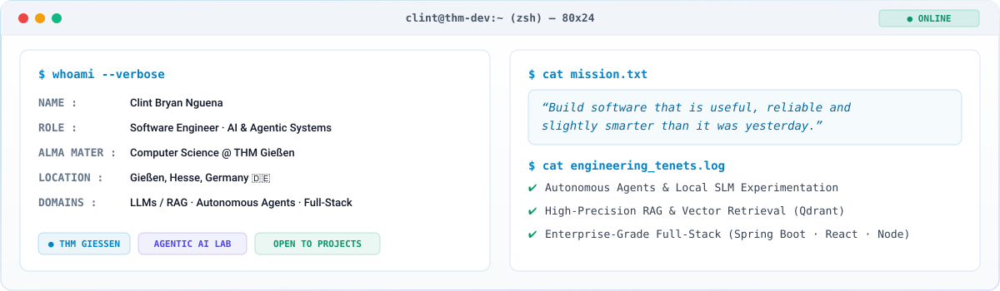
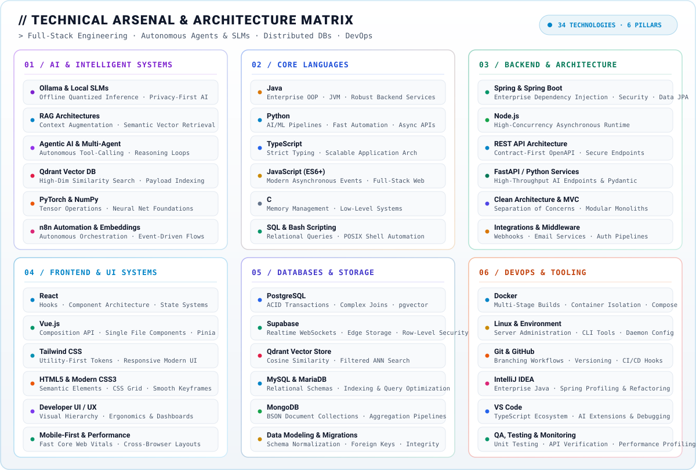
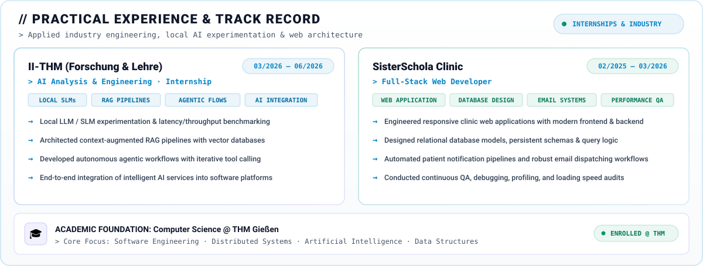
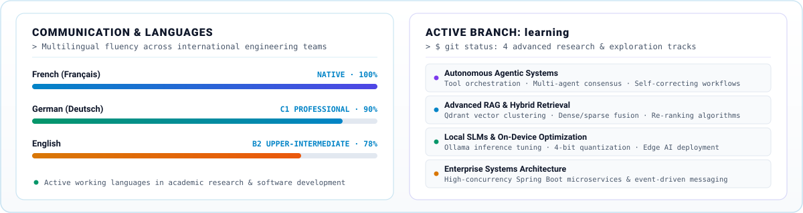
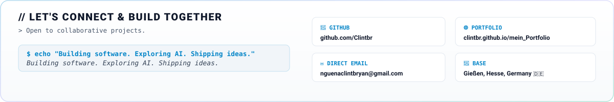

<!-- ==================== HEADER ==================== -->
<picture>
  <source media="(prefers-color-scheme: dark)" srcset="assets/header-dark.svg">
  
</picture>

 

<!-- ==================== ABOUT TERMINAL ==================== -->
<picture>
  <source media="(prefers-color-scheme: dark)" srcset="assets/about-dark.svg">
  
</picture>

 

<picture>
  <source media="(prefers-color-scheme: dark)" srcset="assets/divider-dark.svg">
  
</picture>

 

<!-- ==================== TECHNICAL ARSENAL ==================== -->
<picture>
  <source media="(prefers-color-scheme: dark)" srcset="assets/tech-stack-dark.svg">
  
</picture>

 

<picture>
  <source media="(prefers-color-scheme: dark)" srcset="assets/divider-dark.svg">
  
</picture>

 

<!-- ==================== EXPERIENCE & MILESTONES ==================== -->
<picture>
  <source media="(prefers-color-scheme: dark)" srcset="assets/experience-dark.svg">
  
</picture>

 

<picture>
  <source media="(prefers-color-scheme: dark)" srcset="assets/divider-dark.svg">
  
</picture>

 

<!-- ==================== SPOKEN LANGUAGES & RESEARCH ==================== -->
<picture>
  <source media="(prefers-color-scheme: dark)" srcset="assets/stats-dark.svg">
  
</picture>

 

<picture>
  <source media="(prefers-color-scheme: dark)" srcset="assets/divider-dark.svg">
  
</picture>

 

<!-- ==================== CONTACT BANNER ==================== -->
<picture>
  <source media="(prefers-color-scheme: dark)" srcset="assets/contact-dark.svg">
  
</picture>

  

<!-- ==================== DIRECT CLICKABLE LINKS ==================== -->

&nbsp;&nbsp;

&nbsp;&nbsp;

  

